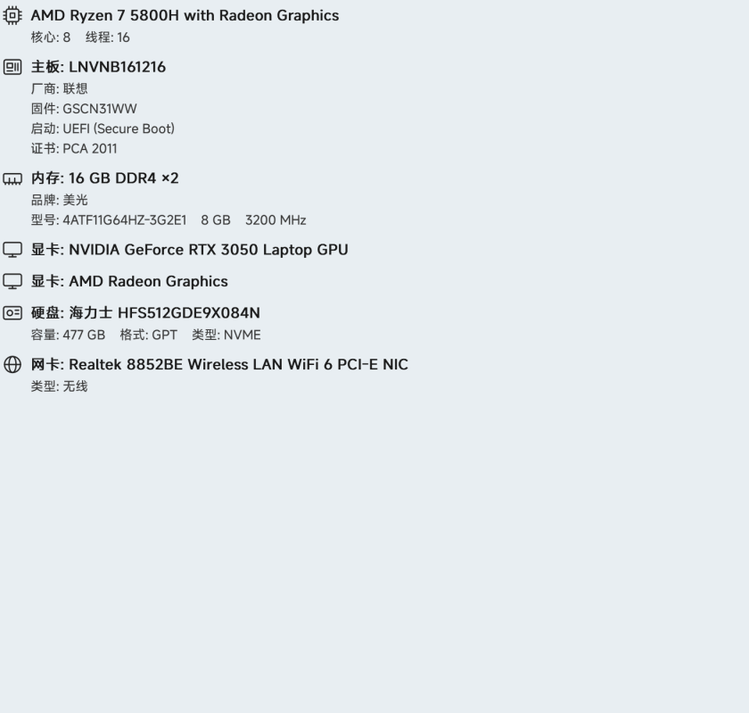

# HSpec 轻谱

轻量、零依赖的桌面硬件信息面板。纯 Win32 C++，直接画在桌面层上：**不置顶、背景透明、不吃焦点**。



```
┌ 桌面（壁纸层）
│                                        [图标] Intel(R) Core(TM) i9-10850K CPU @ 3.60GHz
│                                               核心: 10    线程: 20
│                                        [图标] 主板: ROG STRIX Z490-E GAMING
│                                               厂商: ASUSTeK COMPUTER INC.
│                                               固件: 2801
│                                               启动: UEFI (Secure Boot)
│                                               证书: PCA 2011
│                                        [图标] 内存: 32 GB DDR4 ×2
│                                               型号: CMK32GX4M2B3200C16    16 GB    3200 MHz
│                                        [图标] 显卡: NVIDIA GeForce RTX 3050 Laptop GPU
│                                        [图标] 显卡: AMD Radeon Graphics
│                                        [图标] 硬盘: Samsung SSD 970 EVO Plus 1TB
│                                               容量: 932 GB    格式: GPT    类型: NVME
│                                        [图标] 网卡: Realtek 8852BE Wireless LAN WiFi 6 PCI-E NIC
│                                               类型: 无线
└ 图标区
```

## 特性

- **桌面层显示**：普通顶层分层窗口，z-order 锚定在 `Progman/WorkerW` 桌面栈之上、所有普通窗口之下；从不使用 `WS_EX_TOPMOST`，按 `Win+D` 后也会自动回到桌面。
- **逐像素透明**：GDI+ 32bpp 位图 + `UpdateLayeredWindow`，文字抗锯齿，无白底、无边框；面板本身点击穿透。
- **自动明暗**：读取当前壁纸（`SPI_GETDESKWALLPAPER`）并采样面板区域的亮度，深色壁纸自动切换为浅色文字，浅色壁纸用深色文字；壁纸切换后 1 秒内自动更新。
- **内嵌 MiSans**：MiSans Medium 子集（ASCII + 界面文案 + 硬件/厂商常用字，约 172 KB）。文本用 **GDI ClearType** 渲染后再提取 alpha，100% DPI 下也保持锐利；子集外的生僻字整行自动回退系统字体，不会出现方块。
- **托盘图标**：右键或双击托盘图标打开菜单（刷新 / 退出）；面板本身不再响应鼠标。
- **自动刷新**：设备增删（`WM_DEVICECHANGE`）、壁纸切换、分辨率/DPI 变化都会自动重建信息。
- **显卡识别**：SetupAPI 枚举显示设备，按 `VEN_DEV` 查内嵌 PCI ID 表。PE 里只有 Microsoft 基础显示驱动时也能识别真实显卡型号；自动过滤虚拟显示器。
- **网卡识别**：按 `VEN_DEV` 查表，区分 **无线 / 有线**（`CC_0280` + 名称关键词），过滤虚拟网卡、WAN Miniport、蓝牙 PAN 等。
- **零第三方依赖**：不使用 WMI、PowerShell、`msinfo32`、`wmic`，不释放任何临时文件。
- **单文件源码**：`hspec.cpp` 一个翻译单元；资源为图标、字体子集、manifest 和版本信息。
- **多架构**：x64 / x86 / arm64，GitHub Actions 全量编译。
- **Win7+**：不依赖 XP；使用 `UpdateLayeredWindow` 实现逐像素透明。

## 硬件信息是怎么采集的

和 [WinosInfo](https://wuyou.net/forum.php?mod=viewthread&tid=427978) 这类工具的路径一致：**SMBIOS 原始表 + UEFI 变量 + 注册表 + 物理磁盘 IOCTL**。

| 项目 | 来源 | 关键 API / 数据 |
| :--- | :--- | :--- |
| CPU 名称 | 注册表 + CPUID 兜底 | `HKLM\HARDWARE\DESCRIPTION\System\CentralProcessor\0\ProcessorNameString`，`__cpuid(0x80000002..4)` |
| 核心 / 线程 | 拓扑枚举 | `GetLogicalProcessorInformationEx(RelationProcessorCore)`、`GetActiveProcessorCount` |
| 主板 / BIOS / 内存条 | SMBIOS 原始表，注册表兜底 | `GetSystemFirmwareTable('RSMB')`；失败时读 `HKLM\SYSTEM\CurrentControlSet\Services\mssmbios\Data\SMBiosData`，再兜底 `HKLM\HARDWARE\DESCRIPTION\System\BIOS` |
| 内存总量 | 系统 | `GetPhysicallyInstalledSystemMemory`（已安装），`GlobalMemoryStatusEx`（可用量兜底） |
| 固件类型 | 内核 + 注册表兜底 | `GetFirmwareType()`（动态加载），`PEFirmwareType` |
| 安全启动状态 | 注册表 / UEFI 变量 | `...\Control\SecureBoot\State\UEFISecureBootEnabled`，`GetFirmwareEnvironmentVariableW` |
| 安全启动证书 | UEFI `db` / `dbx` | 解析 `EFI_SIGNATURE_LIST` → X.509 → `CertGetNameStringW` |
| 硬盘型号 / 总线 | 物理磁盘 | `\\.\PhysicalDriveN` + `IOCTL_STORAGE_QUERY_PROPERTY` |
| 容量 | 物理磁盘 | `IOCTL_DISK_GET_DRIVE_GEOMETRY_EX`（免管理员） |
| 分区格式 | 物理磁盘 | `IOCTL_DISK_GET_DRIVE_LAYOUT_EX` → MBR / GPT / RAW |
| 显卡 | SetupAPI + 内嵌 PCI ID 表 | `SetupDiGetClassDevs` 显示类，`VEN_DEV` 查表；驱动不可用时仍可识别 |
| 网卡 | SetupAPI + 内嵌 PCI ID 表 | `SetupDiGetClassDevs` 网络类，`VEN_DEV` 查表；`CC_0280`/名称关键词区分无线与有线 |

> 程序以 `requireAdministrator` 启动（读取 UEFI `db` 证书需要管理员权限）。证书行紧跟在“启动”后面：2023 与 2011 都存在时显示 `PCA 2011/CA 2023`，否则显示实际存在的那个；固件变量不可读时用 Windows 的 CA servicing 状态兜底。
>
> 内存条型号来自 SMBIOS Type 17。若系统禁用了固件表接口（部分虚拟机/精简系统），会自动降级为只显示已安装总量。

## 使用

1. 运行 `HSpec.exe`，面板出现在主屏右上角。
2. 托盘区找到 HSpec 图标（可能收在 `^` 里）：右键或双击打开菜单，选择 **刷新 / 退出**。
3. 信息每 60 秒自动刷新；插入/移除设备、切换壁纸、改变分辨率或 DPI 时会立即刷新。

单实例运行（互斥量 `HSpec_Singleton`）。不写注册表、不开机自启、不联网。

## 构建

本地（需要 Visual Studio 2019+ 的开发者命令提示符）：

```cmd
build.cmd
```

CI 每次 push 自动编译 x64 / x86 / arm64 并上传 artifact，见 `.github/workflows/build.yml`。

字体子集已入库（`winres/MiSans-Medium.ttf`）。如需重建（新增界面文案 / 厂商字后）：

```cmd
python tools/subset_font.py --full <完整 MiSans-Medium.ttf>
python tools/subset_font.py --check
```

`tools/hardware_words.txt` 维护中文厂商与硬件词汇；新增品牌名后重跑子集即可。`--minimal` 只保留界面文案与 ASCII。

显卡/网卡 ID 表（`data/gpu_ids.txt`、`data/nic_ids.txt`）由参考工具的 IDS 导出生成：

```cmd
python tools/build_ids.py --gpu <显卡ID.IDS> --nic <网卡ID.ids>
```

手动编译命令：

```cmd
rc /nologo /c65001 /fo build\hspec.res hspec.rc
cl /nologo /utf-8 /O2 /MT /EHsc /std:c++17 /D_WIN32_WINNT=0x0601 hspec.cpp build\hspec.res ^
   /link /OUT:dist\HSpec.exe /SUBSYSTEM:WINDOWS ^
   gdiplus.lib crypt32.lib advapi32.lib user32.lib gdi32.lib
```

## 与 HKeyboard / HRime 的关系

同一套做法：单文件纯 Win32 C++、MSVC 静态 CRT、GitHub Actions 三架构编译。命名沿用 `H` + 英文 / `轻` + 单字：HKeyboard / 轻键、HRime / 轻韵、**HSpec / 轻谱**。

## License

MIT
